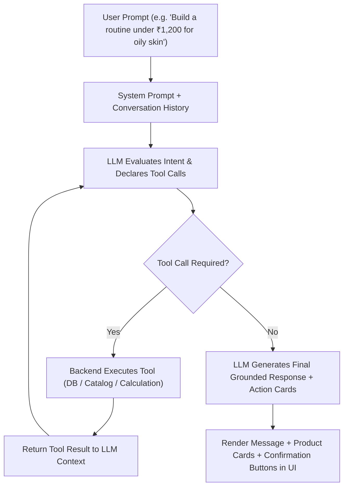

# Agentic AI Assistant & Tool-Calling Architecture

This skill defines the development of the intelligent conversational skincare assistant for SKINMATE AI. The assistant operates as an **agentic tool-caller** that queries real application databases, filters genuine product catalogs, and calculates totals, rather than hallucinating product information or prices.

---

## 1. Agent Architecture & Multi-Step Execution Loop

The agent follows an explicit ReAct (Reason + Act) tool-calling lifecycle:



---

## 2. Defined Assistant Backend Tools

The assistant must only interact with application state through these strictly typed tools:

```typescript
// src/lib/ai/tools.ts
import { z } from "zod";

export const assistantTools = [
  {
    name: "get_user_profile",
    description: "Retrieves the current user's skincare profile, concerns, skin type, and budget limits.",
    parameters: z.object({}),
  },
  {
    name: "get_latest_skin_analysis",
    description: "Retrieves the user's latest YouCam skin analysis results, scores, and detected concerns.",
    parameters: z.object({}),
  },
  {
    name: "search_products",
    description: "Searches the curated skincare catalog by category, price limit, concern, or ingredient.",
    parameters: z.object({
      category: z.enum(["cleanser", "toner", "serum", "moisturiser", "sunscreen", "treatment"]).optional(),
      maxPriceInr: z.number().optional(),
      concern: z.string().optional(),
      skinType: z.string().optional(),
      excludeIngredients: z.array(z.string()).optional(),
    }),
  },
  {
    name: "compare_products",
    description: "Compares 2 or 3 products side-by-side on price, active ingredients, and suitability.",
    parameters: z.object({
      productIds: z.array(z.string()).min(2).max(3),
    }),
  },
  {
    name: "calculate_routine_total",
    description: "Calculates the total cost in INR of a given combination of product IDs and compares to budget.",
    parameters: z.object({
      productIds: z.array(z.string()).min(1),
      userBudgetMax: z.number().optional(),
    }),
  },
  {
    name: "request_routine_save_confirmation",
    description: "Prepares a proposed morning/evening routine and asks the user for explicit confirmation before saving.",
    parameters: z.object({
      routineName: z.string(),
      timeOfDay: z.enum(["morning", "evening", "both"]),
      steps: z.array(
        z.object({
          stepName: z.string(),
          productId: z.string(),
          instructions: z.string(),
        })
      ),
      totalPriceInr: z.number(),
    }),
  },
];
```

---

## 3. Strict Grounding & Anti-Hallucination Rules

The system prompt for the AI assistant must enforce strict guardrails:
1. **Catalog Truth Only:** Never recommend a product, brand, or price that does not exist in the curated catalog returned by `search_products`.
2. **Deterministic Math:** Always use `calculate_routine_total` to calculate prices and totals; never calculate sums mentally.
3. **No Medical Claims:** Frame all guidance as cosmetic routine suggestions (e.g. "helps support skin hydration", "helps cleanse excess sebum") and never claim to "cure acne" or "treat dermatitis".
4. **Human Confirmation for Mutations:** Never modify or overwrite a user's saved routine without returning an interactive confirmation card for the user to approve.

---

## 4. Structured Output Format for the Chat UI

The assistant returns a combination of conversational markdown and structured actionable widgets:

```typescript
export interface AssistantResponsePayload {
  message: string;
  suggestedFollowUps?: string[];
  productCards?: Array<{
    id: string;
    name: string;
    brand: string;
    priceInr: number;
    category: string;
    matchReason: string;
  }>;
  pendingAction?: {
    actionType: "save_routine" | "replace_product";
    payload: Record<string, unknown>;
  };
}
```
