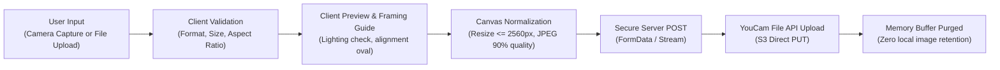

# Facial Image Processing & Secure Upload Architecture

This skill governs the front-to-back pipeline for capturing, validating, resizing, and securely transmitting facial photographs to the YouCam Skin AI engine.

---

## 1. Complete Image Pipeline Architecture



---

## 2. Browser Camera Capture Implementation (WebRTC & Canvas)

```typescript
// src/components/scan/CameraCapture.tsx
"use client";
import React, { useRef, useState, useEffect } from "react";

export function CameraCapture({ onCapture }: { onCapture: (blob: Blob) => void }) {
  const videoRef = useRef<HTMLVideoElement>(null);
  const [stream, setStream] = useState<MediaStream | null>(null);
  const [error, setError] = useState<string | null>(null);

  useEffect(() => {
    async function startCamera() {
      try {
        const mediaStream = await navigator.mediaDevices.getUserMedia({
          video: {
            facingMode: "user",
            width: { ideal: 1920 },
            height: { ideal: 1080 },
          },
        });
        setStream(mediaStream);
        if (videoRef.current) {
          videoRef.current.srcObject = mediaStream;
        }
      } catch (err: any) {
        setError("Camera permission denied or camera unavailable. Please upload a photo instead.");
      }
    }
    startCamera();
    return () => {
      stream?.getTracks().forEach((track) => track.stop());
    };
  }, []);

  const captureFrame = () => {
    if (!videoRef.current) return;
    const video = videoRef.current;
    const canvas = document.createElement("canvas");
    canvas.width = video.videoWidth;
    canvas.height = video.videoHeight;
    const ctx = canvas.getContext("2d");
    if (!ctx) return;

    // Draw video frame to canvas
    ctx.drawImage(video, 0, 0, canvas.width, canvas.height);

    canvas.toBlob(
      (blob) => {
        if (blob) {
          onCapture(blob);
        }
      },
      "image/jpeg",
      0.92
    );
  };

  return (
    <div className="relative overflow-hidden rounded-2xl bg-black">
      {error ? (
        <div className="p-6 text-center text-white">{error}</div>
      ) : (
        <>
          <video ref={videoRef} autoPlay playsInline muted className="w-full h-auto object-cover" />
          {/* Face Alignment Oval Overlay */}
          <div className="pointer-events-none absolute inset-0 flex items-center justify-center">
            <div className="w-64 h-80 rounded-[50%] border-2 border-white/60 border-dashed" />
          </div>
          <button
            onClick={captureFrame}
            className="absolute bottom-6 left-1/2 -translate-x-1/2 h-14 w-14 rounded-full border-4 border-white bg-brand-sage-500 shadow-lg active:scale-95 transition-transform"
            aria-label="Capture photograph"
          />
        </>
      )}
    </div>
  );
}
```

---

## 3. YouCam Image Constraints & Pre-Upload Resizing

The YouCam Skin AI API specifies exact image constraints:
* **Supported Dimensions:** Maximum 2560px on the long side; at least 480px on the short side (SD) or 1080px (HD).
* **Supported Formats:** JPG, PNG.
* **File Size Limit:** Must be under 10MB (recommended 500KB – 3MB).

### Client/Server Resizing Utility:
```typescript
export async function normalizeImageDimensions(file: Blob): Promise<{ buffer: Buffer; fileName: string }> {
  // If running in browser or Node.js environment, ensure dimensions adhere to max 2560px
  const arrayBuffer = await file.arrayBuffer();
  const buffer = Buffer.from(arrayBuffer);
  return {
    buffer,
    fileName: `scan_${Date.now()}.jpg`,
  };
}
```

---

## 4. Guidance for Optimal Photographic Capture

Present clear visual instructions prior to capture:
1. **Lighting:** Face a natural light source (e.g. window). Avoid backlighting or strong overhead shadows.
2. **Angle:** Keep the face centered and looking directly forward into the camera lens.
3. **Hair & Accessories:** Keep hair off the forehead and cheeks; remove glasses or tinted lenses.
4. **No Filters:** Strictly avoid beauty filters or digital post-processing.
