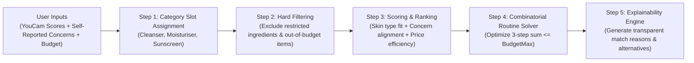

# Deterministic eCommerce Recommendation & Budget Engine

This skill defines the algorithmic recommendation and budget optimization engine for SKINMATE AI. The engine relies on **deterministic, transparent matching rules** rather than unpredictable probabilistic LLM guesses.

---

## 1. Recommendation Pipeline Overview



---

## 2. Product Relevance Scoring Formula

Every eligible product in the catalog receives a deterministic relevance score ($0 \le S \le 100$):

$$S = (W_{\text{type}} \times M_{\text{type}}) + (W_{\text{concern}} \times M_{\text{concern}}) + (W_{\text{budget}} \times M_{\text{budget}})$$

Where:
* $M_{\text{type}} \in \{0, 1\}$: $1$ if product explicitly lists the user's skin type (e.g. "oily"), otherwise $0.5$.
* $M_{\text{concern}} \in [0, 1]$: Ratio of matched user concerns (e.g. product targets acne and pores; user has acne and pores $= 1.0$).
* $M_{\text{budget}} \in [0, 1]$: Price efficiency relative to the step's allocated budget ceiling ($1.0 - \frac{\text{price}}{\text{allocatedBudget}}$).
* Weights: $W_{\text{type}} = 35$, $W_{\text{concern}} = 45$, $W_{\text{budget}} = 20$.

> **Crucial Rule:** Clearly describe this score as an *"Application Relevance Score"* based on user preferences, **not** a clinically validated medical compatibility score.

---

## 3. Combinatorial Budget Routine Solver

When a user requests a complete routine within a budget (e.g. under ₹1,500), the solver selects a cohesive multi-step routine:

```typescript
// src/lib/recommendation/budget-solver.ts
export interface RoutineSlot {
  category: "cleanser" | "moisturiser" | "sunscreen" | "serum";
  required: boolean;
  priorityOrder: number;
}

export const ESSENTIAL_SLOTS: RoutineSlot[] = [
  { category: "cleanser", required: true, priorityOrder: 1 },
  { category: "moisturiser", required: true, priorityOrder: 2 },
  { category: "sunscreen", required: true, priorityOrder: 3 },
  { category: "serum", required: false, priorityOrder: 4 }, // Added only if budget permits
];

export function buildOptimalBudgetRoutine(
  catalog: Product[],
  userProfile: UserProfile,
  maxBudgetInr: number
): { selectedProducts: Product[]; totalInr: number; remainingBudget: number } {
  // 1. Filter out products with restricted ingredients
  const safeCatalog = catalog.filter(p => 
    !p.keyIngredients.some(ing => userProfile.ingredientRestrictions.includes(ing.toLowerCase()))
  );

  // 2. Rank candidates for each essential category
  const cleansers = rankCandidates(safeCatalog.filter(p => p.category === "cleanser"), userProfile);
  const moisturisers = rankCandidates(safeCatalog.filter(p => p.category === "moisturiser"), userProfile);
  const sunscreens = rankCandidates(safeCatalog.filter(p => p.category === "sunscreen"), userProfile);

  // 3. Find optimal combination that respects maxBudgetInr
  let bestCombination: Product[] = [];
  let bestScore = -1;

  for (const c of cleansers.slice(0, 4)) {
    for (const m of moisturisers.slice(0, 4)) {
      for (const s of sunscreens.slice(0, 4)) {
        const totalCost = c.priceInr + m.priceInr + s.priceInr;
        if (totalCost <= maxBudgetInr) {
          const comboScore = c.score + m.score + s.score;
          if (comboScore > bestScore) {
            bestScore = comboScore;
            bestCombination = [c, m, s];
          }
        }
      }
    }
  }

  // 4. Fallback: if top combinations exceed budget, choose lowest-cost alternatives in each category
  if (bestCombination.length === 0) {
    const cheapestC = cleansers.sort((a, b) => a.priceInr - b.priceInr)[0];
    const cheapestM = moisturisers.sort((a, b) => a.priceInr - b.priceInr)[0];
    const cheapestS = sunscreens.sort((a, b) => a.priceInr - b.priceInr)[0];
    bestCombination = [cheapestC, cheapestM, cheapestS].filter(Boolean);
  }

  const totalInr = bestCombination.reduce((acc, p) => acc + p.priceInr, 0);
  return {
    selectedProducts: bestCombination,
    totalInr,
    remainingBudget: maxBudgetInr - totalInr,
  };
}
```

---

## 4. Transparent Match Explanations

Every recommended item must generate a user-facing explanation card:
* **Why it was shortlisted:** *"Contains 2% Niacinamide, matching your visible pore and oiliness observations from your skin analysis."*
* **Budget Context:** *"Priced at ₹349, allowing your complete 3-step routine to remain under your ₹1,500 target at ₹1,147."*
* **Safety & Usage:** *"Formulated without artificial fragrance. Recommended for morning and evening application."*
