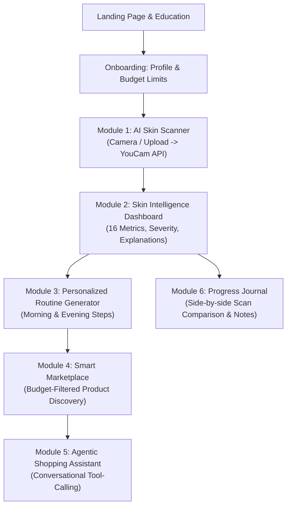

# SKINMATE AI Product Architecture & Module Blueprint

This skill serves as the master architectural specification for **SKINMATE AI**. It enforces clean modular boundaries and seamless data transitions across the complete user lifecycle.

---

## 1. End-to-End User Journey & Data Flow

---

## 2. Core Functional Modules

### Module 1: AI Skin Scanner
* **Purpose:** Capture or upload facial photograph and execute YouCam Skin AI assessment.
* **Key Components:**
  * `CameraCaptureModal`: Direct access to device webcam with framing oval and lighting guide.
  * `PhotoUploader`: Drag-and-drop file upload with client-side resolution and size validation.
  * `ScanProgressIndicator`: Multi-step progress animation (Uploading → Analyzing → Interpreting).
* **Output:** Normalized analysis record containing scores and mask URLs.

### Module 2: Skin Intelligence Dashboard
* **Purpose:** Transform technical diagnostic data into actionable consumer insights.
* **Key Components:**
  * `OverallScoreRadial`: Visual circular progress ring showing primary skin score (0–100).
  * `ConcernBreakdownGrid`: Expandable cards for each detected concern (texture, pores, acne, dark circles, etc.) with severity badges and plain-language definitions.
  * `MaskOverlayViewer`: Interactive toggle to view heatmap overlays on the user's scan.
  * `ActionableTakeawayCard`: 3 immediate practical next steps.

### Module 3: Personalized Routine Generator
* **Purpose:** Construct minimal, effective morning and evening regimens tailored to findings.
* **Key Components:**
  * `MorningRoutineCard`: Step 1: Cleanser → Step 2: Moisturizer → Step 3: Sunscreen.
  * `EveningRoutineCard`: Step 1: Cleanser → Step 2: Targeted Treatment (optional) → Step 3: Moisturizer.
  * `RoutineCustomizer`: One-click buttons to swap products, view ingredient synergy, or toggle completion.

### Module 4: Smart Product Marketplace
* **Purpose:** Budget-conscious eCommerce discovery powered by genuine Indian and global skincare catalogs.
* **Key Components:**
  * `BudgetSlider`: Filter products and routines dynamically by ₹500, ₹1,000, ₹1,500, or ₹3,000 budgets.
  * `ProductCard`: High-resolution product image, brand, INR price, category tag, key actives, and "Why it matches you" tooltip.
  * `AffordableAlternativeDrawer`: Suggests lower-cost swaps for expensive items.

### Module 5: Agentic AI Skincare Assistant
* **Purpose:** Conversational co-pilot capable of executing application actions via backend tools.
* **Key Components:**
  * `AssistantDrawer`: Slide-over chat interface accessible throughout the app.
  * `ActionProposalCard`: Interactive UI cards for adding products to routine or swapping items with user approval.
  * `ToolExecutionBadge`: Indicates when the assistant is querying the catalog or calculating prices.

### Module 6: Progress Tracker & Skincare Journal
* **Purpose:** Track skin journey over weeks or months with side-by-side historical scans.
* **Key Components:**
  * `ComparisonSlider`: Compare previous scan vs current scan metrics side-by-side.
  * `MetricTrendChart`: Historical Recharts line graph showing change in concern scores over time.
  * `JournalEntryForm`: Log daily notes (e.g. "Started using new cleanser", "Late night / stress").

---

## 3. Data Integration & State Boundaries

* **Session Storage / Cache:** Unauthenticated users can perform a full demo scan, view the dashboard, and explore products using local state.
* **Supabase Persistence:** When a user logs in, their profile, saved routine, and analysis history synchronize to PostgreSQL with Row Level Security (RLS).
* **Non-Medical Boundary:** Every module prominently displays the cosmetic guidance disclaimer.
