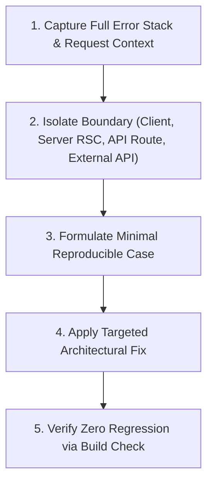

# Testing, Debugging & Quality Verification Runbook

This skill establishes testing protocols, build verification procedures, and structured debugging methodologies for SKINMATE AI.

---

## 1. Quality Verification Runbook (Pre-Submission Checklist)

Before committing code or deploying to staging/production, run the 4-phase verification pipeline:

```bash
# Phase 1: Strict TypeScript Type-Check
npx tsc --noEmit

# Phase 2: ESLint & Code Formatting
npm run lint

# Phase 3: Unit & Integration Tests
npm test

# Phase 4: Production Build Verification
npm run build
```

---

## 2. Structured Root-Cause Debugging Methodology

When an error occurs, follow the **5-Step Root-Cause Protocol** rather than applying hasty band-aids:



---

## 3. Common Next.js App Router Pitfalls & Solutions

### A. React Hydration Mismatch
* **Symptoms:** `Warning: Text content did not match. Server: "..." Client: "..."`
* **Root Causes:** Using non-deterministic values (e.g. `Date.now()`, `Math.random()`, or browser-only `window.localStorage`) during initial render.
* **Resolution:** Move client-dependent initialization into `useEffect()` or suppress with `suppressHydrationWarning` on specific isolated elements:
  ```tsx
  const [mounted, setMounted] = useState(false);
  useEffect(() => setMounted(true), []);
  if (!mounted) return <SkeletonLoader />;
  ```

### B. Leaking Server Secrets to Client Components
* **Symptoms:** API key is `undefined` on the client or appears in client-side bundle source maps.
* **Root Causes:** Attempting to read `process.env.YOUCAM_API_KEY` inside a component marked with `"use client"`.
* **Resolution:** Keep secret API calls strictly in Route Handlers (`src/app/api/...`) or Server Components. Pass only processed public data down to the client.

### C. Third-Party API Network Hangs
* **Symptoms:** User sees infinite loading spinner during skin scan.
* **Root Causes:** Missing `AbortController` timeout on external `fetch()` calls.
* **Resolution:** Always wrap external calls with a 15–30 second timeout and display a human-readable recovery message with a retry button.

---

## 4. API Mocking for Deterministic Testing

When testing recommendation algorithms or UI dashboards without consuming live YouCam units, use structured mock harnesses:

```typescript
// src/lib/testing/mock-youcam.ts
export const MOCK_YOUCAM_SUCCESS_RESPONSE = {
  status: 200,
  data: {
    task_status: "success",
    results: {
      output: [
        { type: "pore", ui_score: 72, raw_score: 65.4 },
        { type: "texture", ui_score: 68, raw_score: 59.2 },
        { type: "acne", ui_score: 84, raw_score: 80.1 },
        { type: "moisture", ui_score: 60, raw_score: 50.0 },
        { type: "oiliness", ui_score: 55, raw_score: 45.0 },
      ],
    },
  },
};
```
