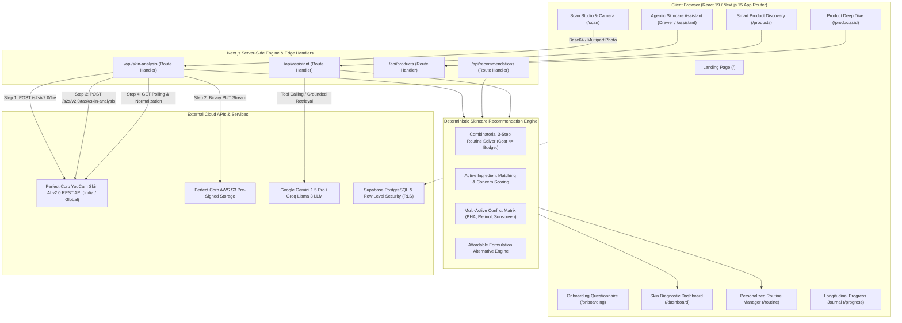
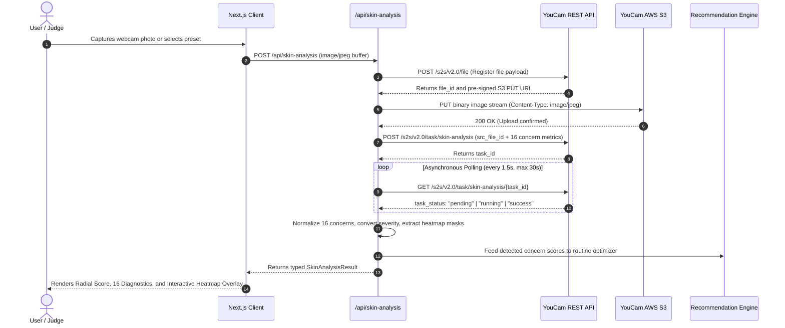

# SKINMATE AI — Comprehensive Product & System Architecture

**Platform:** AI-Powered Personal Skincare Intelligence & Smart Shopping Platform  
**Target Hackathon:** YouCam API Skin AI & eCommerce VTO Hackathon (hosted by Perfect Corp on Devpost)  
**Stack:** Next.js 15 (App Router), React 19, TypeScript, Tailwind CSS, Perfect Corp YouCam Skin AI REST API v2.0/v2.1, Supabase (PostgreSQL & Auth), Recharts, Lucide Icons.

---

## 1. High-Level Architectural Diagram

---

## 2. YouCam Skin AI Asynchronous Integration Pipeline

The platform communicates with Perfect Corp's YouCam Skin AI REST API (`https://yce-api-01.makeupar.com` for India or `https://yce-api-01.perfectcorp.com` for Global) via a secure server-side 4-step orchestration:

### 16 Detectable Cosmetic Concern Metrics
1. `pore`: Visible pores and follicle congestion
2. `texture`: Epidermal smoothness and micro-relief
3. `acne`: Surface blemishes, comedones, and congestion
4. `oiliness`: Forehead and T-zone sebum shine balance
5. `moisture`: Superficial hydration and barrier water retention
6. `redness`: Visible facial redness and capillary flushing
7. `dark_circle_v2`: Infraorbital discoloration and dark circles
8. `wrinkle`: Fine superficial lines and elasticity
9. `spot`: Age spots, sun spots, and hyperpigmentation
10. `radiance`: Cosmetic skin luminosity and vitality
11. `eyebag`: Under-eye puffiness and fluid contour
12. `firmness`: Dermal bounce, tension, and structural firmness

---

## 3. Skincare Routine Combinatorial Optimizer

To avoid impractical recommendations that exceed user budgets, SKINMATE AI uses a **combinatorial dynamic knapsack solver**:

$$\text{Maximize } \sum_{i \in \{\text{cleanser, moisturiser, sunscreen}\}} \text{RelevanceScore}(p_i) \quad \text{subject to} \quad \sum_{i} \text{PriceINR}(p_i) \le \text{BudgetMax}$$

1. **Step 1: Candidate Pool Partitioning**  
   Curated catalog is partitioned by essential step categories (`cleanser`, `moisturiser`, `sunscreen`, `serum`).
2. **Step 2: Profile & Concern Scoring**  
   Each candidate is scored ($0 - 100$) based on suitability for skin type ($+35$), coverage of YouCam-detected priority concerns ($+18$ per match, up to $+45$), and price efficiency ($+20$).
3. **Step 3: Budget-Constrained Trio Generation**  
   The optimizer searches the top candidate combinations to find the highest total utility trio that strictly satisfies $\text{TotalCost} \le \text{BudgetMax}$.
4. **Step 4: Evening Targeted Add-On**  
   If $\text{BudgetRemaining} \ge \text{SerumCost}$, the highest-ranking treatment serum (e.g., Niacinamide, Vitamin C, or Retinol) is seamlessly sequenced into the evening routine.
5. **Step 5: Affordable Swapping**  
   If the user wishes to lower routine cost, `findAffordableAlternatives()` locates verified lower-cost alternatives in the same category without losing active ingredient compatibility.

---

## 4. Multi-Active Ingredient Conflict Matrix

SKINMATE AI guards user safety through an automated rule engine that inspects active ingredient collisions:

| Primary Active | Colliding Active | Severity | Clinical / Cosmetic Reason | Recommended Safe Alternative |
| :--- | :--- | :--- | :--- | :--- |
| **Exfoliating Acid (AHA/BHA)** | **Missing Sunscreen** | **High** | Accelerates epidermal turnover and increases UV sensitivity; unprotected exposure triggers dark spots. | Add broad-spectrum SPF 30+ or SPF 50 sunscreen to morning routine. |
| **Retinoid** | **Missing Sunscreen** | **High** | Retinoids degrade under UV light and heighten solar sensitivity. | Mandatory daily broad-spectrum morning sunscreen application. |
| **Salicylic Acid (BHA)** | **Retinoid (same step)** | **High** | Simultaneous application compromises stratum corneum barrier, risking peeling, flushing, and redness. | Alternate evenings: BHA on Mon/Wed/Fri, Retinoid on Tue/Thu/Sat. |
| **Pure Vitamin C (L-Ascorbic)** | **Direct AHA/BHA (same step)** | **Moderate** | Dual low pH formulas can overwhelm skin tolerance, causing tingling and barrier dehydration. | Apply Vitamin C in the morning for antioxidant defense; use acids at night. |
| **AHA (Glycolic/Lactic)** | **BHA (Salicylic Acid)** | **Moderate** | Layering multiple strong exfoliants increases transepidermal water loss. | Space out use or switch to a unified gentle multi-acid blend (e.g., LHA). |

---

## 5. Dual-Mode Hackathon Demonstration Architecture

To ensure hackathon judges are **never blocked** by network timeouts, quota exhaustion, or missing environment variables:

1. **Live Mode (`YOUCAM_MODE=live`):**  
   When a valid `YOUCAM_API_KEY` is present, the server executes the live 4-step REST pipeline against Perfect Corp's servers.
2. **High-Fidelity Demo Dataset Fallback (`YOUCAM_MODE=demo`):**  
   If no API key is configured or if the external API returns a quota or network error, the pipeline automatically falls back to an authentic YouCam analysis dataset (`VERIFIED_YOUCAM_DEMO_RESULT`).
3. **Transparent Evaluation Badging:**  
   When running in fallback mode, the UI displays a clean `"Demo Dataset Fallback"` badge explaining that the data is an authentic pre-recorded YouCam response, preserving full interactive functionality (heatmaps, routine generation, conflict checks, and assistant chat).

---

## 6. Cosmetic vs. Medical Safety Boundaries

SKINMATE AI strictly follows cosmetic regulatory standards:
- **Non-medical terminology:** Uses "identifies visible facial characteristics", "visible blemishes", "supports skin barrier", "addresses surface shine".
- **Forbidden terms:** Never uses "diagnoses acne", "cures dermatological disease", "prescribes medicine".
- **Disclaimer enforcement:** Displays clear cosmetic disclaimers on all diagnostic cards, routines, and footers.
