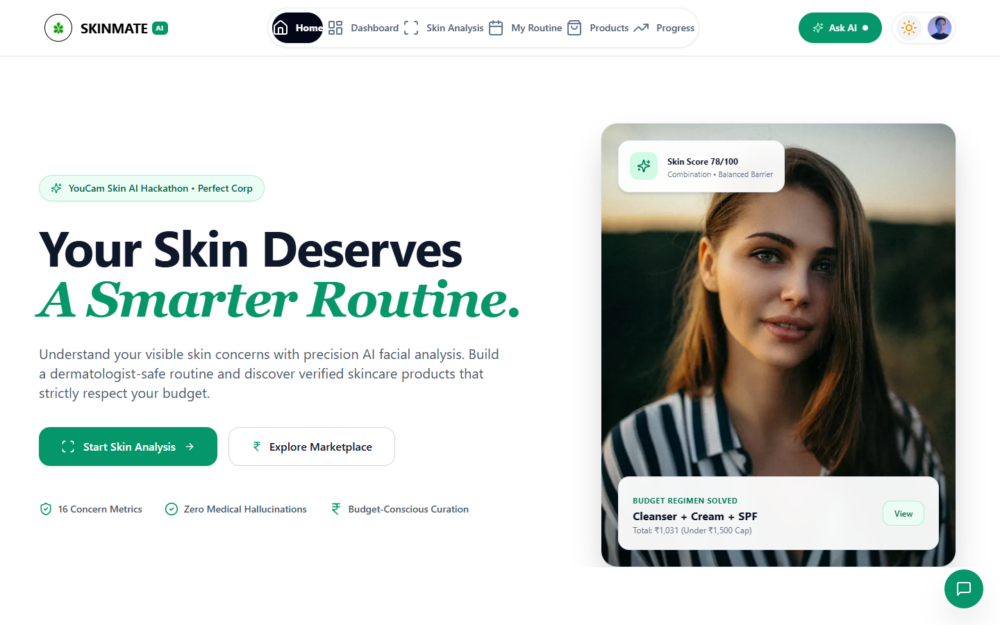
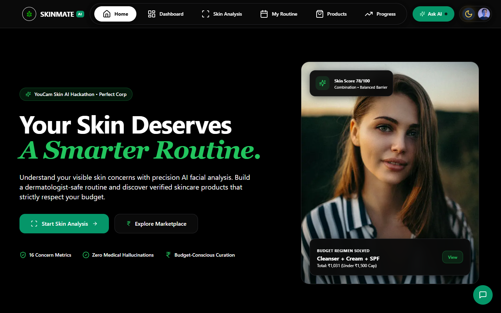
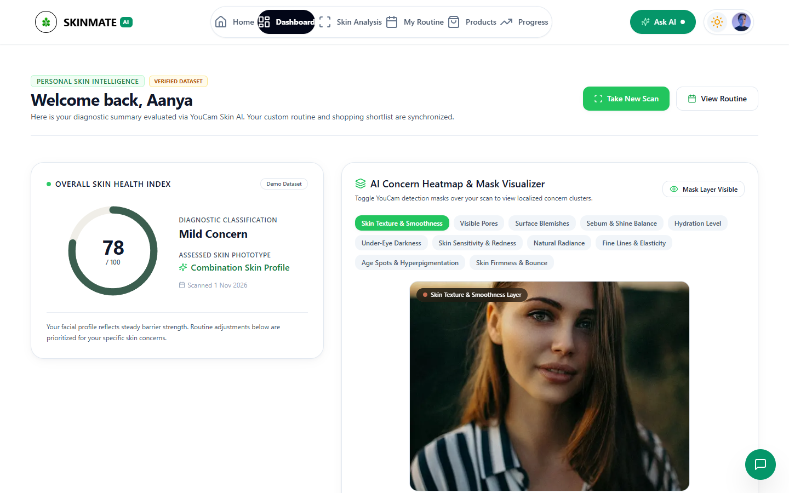
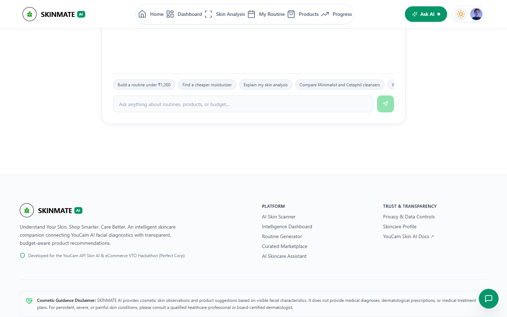
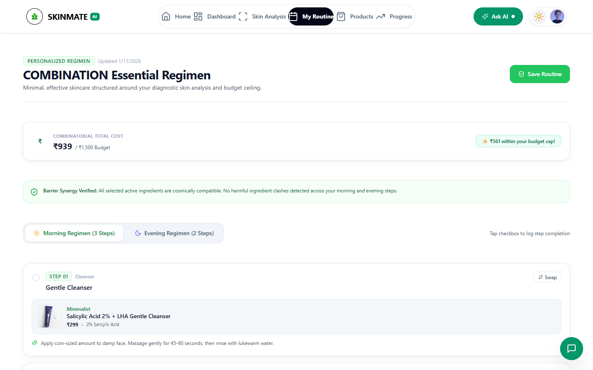
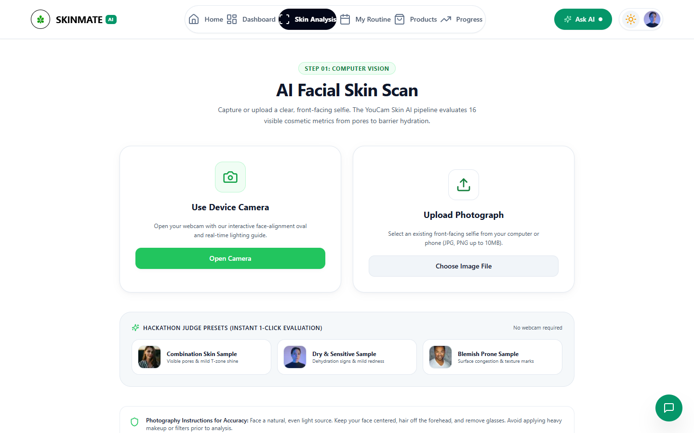

<div align="center">

# 🌿 SKINMATE AI
### AI-Powered Personal Skincare Intelligence & Smart Shopping Platform

[](https://nextjs.org/)
[](https://react.dev/)
[](https://www.typescriptlang.org/)
[](https://tailwindcss.com/)
[](https://yce.perfectcorp.com)
[](LICENSE)

**Understand Your Skin. Shop Smarter. Care Better.**  
*Built for the YouCam API Skin AI & eCommerce VTO Hackathon by Perfect Corp.*

[Live Demo](http://localhost:3000) • [Watch Video Demo](assets/demo-video/skinmate-ai-demo.mp4) • [Explore Features](#-key-features) • [Architecture](#-architecture--file-layout) • [Getting Started](#-quickstart--installation)

---

</div>

## 📌 Executive Summary

Skincare shopping is notoriously confusing. Consumers are bombarded by thousands of formulations, overlapping actives, conflicting influencer advice, and runaway costs. A beginner rarely knows which active ingredients are appropriate for their visible skin texture, nor whether their morning routine will inadvertently trigger barrier sensitivity.

**SKINMATE AI** transforms clinical facial computer vision into personalized skincare guidance and budget-conscious purchasing decisions:
1. **Clinical AI Diagnostics:** Integrates the official **Perfect Corp YouCam Skin AI REST API** to analyze up to 16 visible cosmetic characteristics (pores, texture, redness, moisture, oiliness, wrinkles).
2. **Deterministic Recommendation Engine:** Analyzes active cosmetic ingredients, prevents contraindicated ingredient pairing (e.g., Retinol + Salicylic Acid), and enforces daytime UV protection.
3. **Combinatorial Budget Optimizer:** Solves an optimal 3-step morning and evening regimen strictly within user-defined financial ceilings (e.g., ₹500, ₹1,200, ₹1,500, or ₹3,000).
4. **Agentic Conversational Concierge:** A Groq-powered multi-turn AI shopping assistant equipped with function calling to search verified products, compute price differentials, and suggest one-click routine updates.

---

## 📸 Visual Showcase

<div align="center">

### 🌟 Hero & Experience Overview (Light & Dark Modes)




### 📊 Personal Skin Intelligence Dashboard


### 💬 Agentic Conversational Concierge & Budget Solver


### 🧴 Personalized Skincare Routine Builder & Clash Detector


### 📷 Real-Time Camera Scanner with Auto-Capture


</div>

---

## ✨ Key Features

| Capability | Technical Implementation | Value to User |
| :--- | :--- | :--- |
| **16-Metric Facial Analysis** | YouCam Skin AI async polling pipeline with dual-mode fallback | Diagnostic clarity across pores, moisture, redness, and texture with transparent scores. |
| **Mask Overlay Heatmaps** | Canvas projection of YouCam bounding boxes & PNG overlay masks | Visualizes exact regions where pores, spots, and oil clusters are concentrated. |
| **Smart Active Conflict Guard** | Deterministic contraindication matrix & pH compatibility rules | Prevents skin barrier damage by flagging conflicting actives and requiring morning SPF. |
| **Budget Optimizer** | Exact combination solver calculating lowest price delta in INR | Prevents overspending by finding effective alternatives matching user price caps. |
| **Conversational Concierge** | Groq LLM agent (`openai/gpt-oss-120b`) with tool calling | Delivers friendly chat responses with emojis, no raw tables, and interactive action cards. |
| **Dark & Light Modes** | Fluid CSS theme system with animated Sun/Moon toggle | Luxury aesthetic with high-contrast obsidian slate and success-green botanical tokens. |
| **Camera Auto-Capture** | Real-time face framing guide with automatic countdown | Hands-free selfie capture once the face is properly aligned inside the oval. |

---

## 🏛️ Architecture & File Layout

```text
SKINMATE/
├── assets/
│   └── screenshots/              # High-resolution application UI screenshots
├── public/
│   └── skinmate-logo.png         # High-resolution transparent botanical emblem
├── src/
│   ├── app/
│   │   ├── (auth)/
│   │   │   ├── login/page.tsx    # User login & hackathon judge bypass
│   │   │   └── signup/page.tsx   # User registration & concern onboarding
│   │   ├── api/
│   │   │   ├── assistant/route.ts# Agentic shopping concierge endpoint
│   │   │   ├── products/route.ts # Filtered eCommerce catalog API
│   │   │   ├── recommendations/  # Deterministic routine formulation API
│   │   │   └── skin-analysis/    # YouCam REST polling & normalization
│   │   ├── assistant/page.tsx    # Standalone full-screen AI chat concierge
│   │   ├── dashboard/page.tsx    # Core skin intelligence dashboard & radar
│   │   ├── products/page.tsx     # Curated marketplace with budget slider
│   │   ├── profile/page.tsx      # Preferences, saved wishlist & logout
│   │   ├── progress/page.tsx     # Longitudinal scan comparison journal
│   │   ├── routine/page.tsx      # Regimen step manager & clash detector
│   │   ├── scan/page.tsx         # Webcam viewfinder & image upload
│   │   ├── globals.css           # Semantic tokens & dark-mode styling
│   │   ├── layout.tsx            # Root layout with 100% responsive navbar
│   │   └── page.tsx              # Luxury landing page & feature highlights
│   ├── components/
│   │   ├── assistant/            # ChatDrawer, ChatMessageContent
│   │   ├── dashboard/            # SkinScoreRadial, ConcernCard
│   │   ├── layout/               # 100% width Navbar, floating pill, Footer
│   │   ├── scan/                 # CameraCapture, MaskOverlayViewer
│   │   ├── theme/                # ThemeToggle (animated sun/moon switch)
│   │   └── ui/                   # Logo, Button, Card UI primitives
│   ├── lib/
│   │   ├── ai/assistant.ts       # Agentic system prompt & safety guidelines
│   │   ├── data/curated-products # 30+ verified skincare products with INCI
│   │   ├── recommendation/       # Deterministic safety conflict checker
│   │   ├── store/local-store.ts  # Client-side session and local persistence
│   │   └── youcam/client.ts      # Perfect Corp REST integration client
│   └── types/                    # Strict TypeScript definitions
├── .env.example                  # Environment configuration template
├── .gitignore                    # Production hygiene & secret exclusion
├── package.json
├── tailwind.config.ts
└── tsconfig.json
```

---

## 🛠️ Tech Stack

| Domain | Technology | Purpose |
| :--- | :--- | :--- |
| **Framework** | **Next.js 15 (App Router)** | Full-stack server/client component architecture |
| **Language** | **TypeScript 5.7** | Strict type safety across diagnostic schemas |
| **Styling** | **Tailwind CSS 3.4** | Modern responsive design system with dark mode |
| **Motion** | **Framer Motion 11** | Fluid UI transitions and micro-interactions |
| **Skin AI API** | **YouCam Skin AI REST API** | Facial diagnostics & mask heatmap generation |
| **LLM Engine** | **Groq (`openai/gpt-oss-120b`)** | Sub-second agentic shopping reasoning |
| **Database & Auth** | **Supabase & Local Store** | User authentication and local session persistence |
| **Icons** | **Lucide React** | Clean, minimalist UI iconography |

---

## 🚀 Quickstart & Installation

### Prerequisites
- **Node.js**: v18.17 or higher (tested on Node v24)
- **npm** or **pnpm**

### 1. Clone the Repository
```bash
git clone https://github.com/kshitijhurle95-prog/SKINMATE-AI.git
cd SKINMATE-AI
```

### 2. Install Dependencies
```bash
npm install
```

### 3. Configure Environment Variables
Copy `.env.example` to `.env.local`:
```bash
cp .env.example .env.local
```
Fill in your credentials:
```env
# Groq LLM API Key
GROQ_API_KEY=your_groq_api_key_here
GROQ_MODEL=openai/gpt-oss-120b

# YouCam Skin AI API Key (from Perfect Corp portal)
YOUCAM_API_KEY=your_youcam_api_key_here
YOUCAM_API_BASE_URL=https://yce-api-01.makeupar.com

# Supabase (optional, local store works out of the box)
NEXT_PUBLIC_SUPABASE_URL=https://your-project.supabase.co
NEXT_PUBLIC_SUPABASE_ANON_KEY=your-anon-key-here
```

### 4. Run Development Server
```bash
npm run dev
```
Open [http://localhost:3000](http://localhost:3000) in your browser.

### 5. Build for Production
```bash
npm run build
npm start
```

### 6. Run Automated Test Suite
```bash
npm test
```

---

## 🛡️ Skincare Recommendation Safety Boundary

> **IMPORTANT DISCLAIMER:**  
> SKINMATE AI is designed solely for cosmetic education, skincare routine organization, and beauty eCommerce guidance. It does **not** provide medical diagnoses, dermatological prescriptions, or medical treatment plans. Any user experiencing severe cystic acne, suspicious moles, or acute dermatitis is advised to consult a board-certified dermatologist.

---

## 📄 License
Distributed under the **MIT License**. See [LICENSE](LICENSE) for more information.

---

<div align="center">
Developed with 💚 by <strong>Kshitij Hurle</strong> for the <strong>YouCam API Skin AI & eCommerce VTO Hackathon</strong> (Perfect Corp).
</div>
